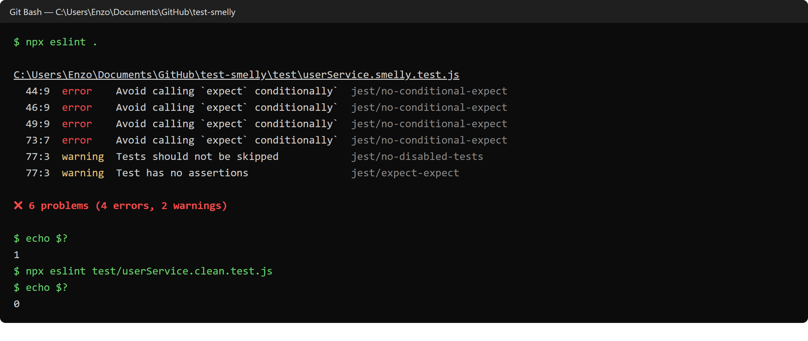

# Refatoração de Testes e Detecção de Test Smells

**Disciplina:** Teste de Software  
**Trabalho:** Refatoração de Testes e Detecção de Test Smells  
**Aluno:** Enzo Casaes Figueiró  
**Matrícula:** 856804  
**Repositório:** https://github.com/Enzocasaes/test-smelly

## 1. Análise de Smells

A suíte original (`test/userService.smelly.test.js`) passa por completo, mas tem problemas que reduzem a capacidade de detectar defeitos. Os três principais são descritos abaixo.

### 1.1 Lógica Condicional no Teste (Conditional Test Logic)

O teste `deve desativar usuários se eles não forem administradores` percorre uma lista com `for` e usa `if/else` para escolher quais asserções rodam. **Por que é um smell:** o teste deixa de ser uma sequência linear e passa a ter caminhos de execução próprios, que também precisariam ser testados. Dois cenários diferentes (usuário comum e administrador) ficam no mesmo teste. **Risco:** se a lista mudar ou um ramo deixar de ser executado, as asserções desse ramo simplesmente não rodam e o teste continua verde. Quando falha, o nome do teste não indica qual cenário quebrou.

### 1.2 Exceção não verificada / teste que passa em silêncio

O teste `deve falhar ao criar usuário menor de idade` chama `createUser` dentro de um `try` e só faz a asserção no `catch`. **Por que é um smell:** o comportamento esperado (lançar exceção) não é afirmado pelo teste. Ele só confere a mensagem *se* a exceção acontecer. **Risco:** se a validação de idade for removida, nenhuma asserção roda e o teste passa. Isso foi confirmado por um experimento de mutação: trocando `if (idade < 18)` por `if (false)` em uma cópia do código, a suíte original continuou toda verde (ver `evidencias/experimento_mutacao_jest.txt`).

### 1.3 Teste Frágil (Fragile Test)

O teste `deve gerar um relatório de usuários formatado` compara a linha completa `ID: ..., Nome: Alice, Status: ativo\n` e o cabeçalho exato do relatório. **Por que é um smell:** o teste fica preso à formatação textual, que o próprio código avisa que "pode mudar no futuro", e não à regra de negócio. **Risco:** uma mudança inofensiva (um espaço, a ordem dos campos, um novo cabeçalho) quebra o teste sem que haja bug, gerando falsos alarmes e desconfiança na suíte.

**Outros smells encontrados:** *Eager Test* em `deve criar e buscar um usuário corretamente`, que testa duas operações (`createUser` e `getUserById`) em um só teste; e *teste desabilitado* (`test.skip` vazio com `TODO`), que dá a impressão de cobertura que não existe.

## 2. Processo de Refatoração

O teste escolhido foi o de desativação, porque concentra lógica condicional, mais de um cenário e asserções que podem não rodar.

**Antes** (`userService.smelly.test.js`):

```js
test('deve desativar usuários se eles não forem administradores', () => {
  const usuarioComum = userService.createUser('Comum', 'comum@teste.com', 30);
  const usuarioAdmin = userService.createUser('Admin', 'admin@teste.com', 40, true);
  const todosOsUsuarios = [usuarioComum, usuarioAdmin];

  for (const user of todosOsUsuarios) {
    const resultado = userService.deactivateUser(user.id);
    if (!user.isAdmin) {
      expect(resultado).toBe(true);
      const usuarioAtualizado = userService.getUserById(user.id);
      expect(usuarioAtualizado.status).toBe('inativo');
    } else {
      expect(resultado).toBe(false);
    }
  }
});
```

**Depois** (`userService.clean.test.js`):

```js
describe('deactivateUser', () => {
  test('desativa um usuário comum', () => {
    // Arrange
    const usuario = userService.createUser('Comum', 'comum@email.com', 30);
    // Act
    const resultado = userService.deactivateUser(usuario.id);
    // Assert
    expect(resultado).toBe(true);
    expect(userService.getUserById(usuario.id).status).toBe('inativo');
  });

  test('não desativa um administrador', () => {
    // Arrange
    const administrador = userService.createUser('Admin', 'admin@email.com', 40, true);
    // Act
    const resultado = userService.deactivateUser(administrador.id);
    // Assert
    expect(resultado).toBe(false);
    expect(userService.getUserById(administrador.id).status).toBe('ativo');
  });

  test('retorna false quando o usuário não existe', () => {
    // Arrange
    const idInexistente = 'id-inexistente';
    // Act
    const resultado = userService.deactivateUser(idInexistente);
    // Assert
    expect(resultado).toBe(false);
  });
});
```

**Decisões tomadas:**

- **Um cenário por teste.** O `for` e o `if/else` foram eliminados; cada caminho virou um teste próprio, com nome que descreve o comportamento. Toda asserção sempre executa, e uma falha aponta direto o cenário quebrado.
- **Padrão AAA.** Cada teste tem preparação, uma única ação e verificações, separadas por comentários.
- **Asserção que faltava.** O original não verificava que o administrador continua `ativo`; a versão nova verifica, além do retorno `false`.
- **Cenário novo.** O caso de ID inexistente, que o código trata mas a suíte original ignorava, ganhou um teste.

As mesmas ideias foram aplicadas ao restante da suíte: o teste de menor de idade passou a usar `expect(() => ...).toThrow(...)`, que falha se a exceção não for lançada; o Eager Test foi dividido entre `createUser` e `getUserById`; o teste do relatório passou a verificar só nome e status (`toContain('Nome: Alice')`), sem depender do ID aleatório nem da linha inteira; e o `test.skip` virou um teste real para a base vazia. Um `test.each` cobre os três campos obrigatórios sem repetir código. Resultado: 12 testes na suíte limpa, todos passando, contra 4 (+1 ignorado) na original.

## 3. Relatório da Ferramenta

O ESLint foi instalado com `eslint-plugin-jest` e configurado em `.eslintrc.json` conforme o enunciado (regras `no-disabled-tests`, `no-conditional-expect` e `no-identical-title`, mais o conjunto `plugin:jest/recommended`). A única diferença é `"sourceType": "script"`, porque o projeto usa `require` (CommonJS). A primeira execução de `npx eslint .` apontou 6 problemas, todos no arquivo original:



**Como a ferramenta automatizou a detecção:**

| Smell (análise manual) | Detectado pelo ESLint? | Regra |
|---|---|---|
| Lógica condicional (linhas 44, 46, 49) | Sim | `jest/no-conditional-expect` |
| Exceção não verificada / `try/catch` (linha 73) | Sim | `jest/no-conditional-expect` |
| Teste desabilitado (linha 77) | Sim | `jest/no-disabled-tests` e `jest/expect-expect` |
| Teste frágil (relatório) | Não | — |
| Eager Test (criar e buscar) | Não | — |

O linter encontrou em segundos, com linha e coluna, os smells com padrão sintático claro: `expect` dentro de `if`/`catch` e testes pulados ou sem asserções. O `expect` no `catch` é tratado como condicional porque só roda se houver exceção, exatamente o risco descrito em 1.2. Como o comando termina com código de saída 1, ele também pode barrar esses problemas automaticamente em um pipeline de CI. Já o teste frágil e o Eager Test dependem do *significado* das asserções e não têm uma forma sintática fixa, por isso só apareceram na análise manual. Após a refatoração, `npx eslint test/userService.clean.test.js` não reporta nenhum erro ou aviso (código de saída 0), e `npm test` passa nas duas suítes (16 aprovados, 1 ignorado na original).

## 4. Conclusão

A suíte original passava por completo e ainda assim não protegia o código: o experimento de mutação mostrou que remover a validação de idade não derrubava nenhum teste dela, enquanto a suíte refatorada falhou na hora. Testes limpos, com um comportamento por teste, sem lógica condicional e com asserções explícitas, são mais fáceis de ler, apontam com precisão o que quebrou e só falham quando há um defeito real, o que reduz o custo de manutenção. Ferramentas de análise estática como o ESLint tornam parte dessa disciplina automática e contínua, pegando smells comuns antes mesmo da revisão de código. Elas não substituem o julgamento de quem escreve o teste, já que smells como o teste frágil exigem entender a intenção, mas juntas as duas práticas mantêm a suíte confiável à medida que o projeto cresce.
